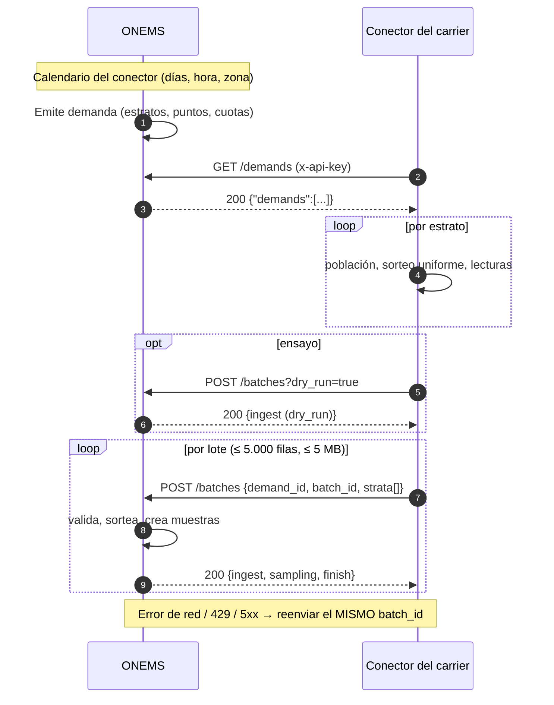

# ONEMS Carrier Link — Especificación de interfaz del conector

| | |
|---|---|
| Documento | Especificación técnica de la interfaz conector del carrier ↔ ONEMS |
| Versión | 1.0 (borrador para revisión) — 2026-11-23 |
| Formato de demanda | `schema_version` **1.1** |
| Destinatarios | Equipo técnico del carrier (desarrollo e integración) |
| Artefactos | [`openapi.yaml`](openapi.yaml) · [`schemas/demand.schema.json`](schemas/demand.schema.json) · [`schemas/batch.schema.json`](schemas/batch.schema.json) · [`ejemplo/`](ejemplo/) |
| Dirección base | `https://<proyecto>.supabase.co/functions/v1/carrier-link-ingest` (la facilita ONEMS) |

Todos los identificadores de los ejemplos son ilustrativos (carrier simulado "SIMPOST").

## Índice

1. [Visión general y arquitectura](#1-visión-general-y-arquitectura)
2. [Convenciones y requisitos normativos](#2-convenciones-y-requisitos-normativos)
3. [Seguridad](#3-seguridad)
4. [Referencia de la API](#4-referencia-de-la-api)
5. [Modelo de datos](#5-modelo-de-datos)
6. [Algoritmo de selección (normativo)](#6-algoritmo-de-selección-normativo)
7. [Semántica operativa](#7-semántica-operativa)
8. [Catálogo de errores y motivos de rechazo](#8-catálogo-de-errores-y-motivos-de-rechazo)
9. [Ficha técnica de equivalencias](#9-ficha-técnica-de-equivalencias)
10. [Conformidad y certificación](#10-conformidad-y-certificación)
11. [Anexos](#11-anexos)

---

## 1. Visión general y arquitectura

### 1.1. Actores

| Actor | Función |
|---|---|
| **ONEMS** | Plataforma del regulador postal. Emite demandas de muestras, recibe lotes, valida, sortea y convierte los envíos elegidos en muestras de calidad de servicio. |
| **Conector** | Programa del carrier. Lee demandas, selecciona envíos en los datos del carrier y entrega sus lecturas en lotes. Es siempre el **cliente**: ONEMS nunca abre conexiones hacia el carrier. |
| **Equipo de ONEMS** | Configura el conector en ONEMS (clave, calendario, equivalencias, puntos de lectura) y lo pasa de pruebas a activo. |

### 1.2. Flujo



Equivalente en texto:

```
ONEMS                                   CONECTOR
  │ emite demanda (calendario)            │
  │◀───────── GET /demands ───────────────│
  │────────── 200 {demands} ─────────────▶│ población → sorteo → lecturas
  │◀───── POST /batches?dry_run=true ─────│ (opcional)
  │────────── 200 {ingest} ──────────────▶│
  │◀───────── POST /batches ──────────────│ (1..n lotes)
  │── 200 {ingest, sampling, finish} ────▶│ guardar; reintento = mismo batch_id
```

### 1.3. Principios

- Comunicación HTTPS servidor a servidor; JSON UTF-8.
- El conector envía **nombres de campo y valores propios del carrier**; ONEMS traduce con las equivalencias (§9).
- Una fila por lectura (escaneo). Sin datos personales.
- Todo se puede ensayar sin efectos (`dry_run`, conector en pruebas).

---

## 2. Convenciones y requisitos normativos

Las palabras **DEBE**, **NO DEBE**, **DEBERÍA**, **NO DEBERÍA** y **PUEDE** se interpretan como MUST, MUST NOT,
SHOULD, SHOULD NOT y MAY de RFC 2119. Tipos: `uuid` (RFC 4122, texto), `date` (`YYYY-MM-DD`), `date-time`
(RFC 3339), `tz` (nombre IANA, p. ej. `Africa/Nairobi`), `int` (entero JSON).

### 2.1. Requisitos

| Id | Requisito | Ref. |
|---|---|---|
| CL-REQ-001 | El conector DEBE usar HTTPS para todas las llamadas. | §3.1 |
| CL-REQ-002 | El conector DEBE enviar la clave en cada petición, en `x-api-key` o en `Authorization: Bearer`. | §3.2 |
| CL-REQ-003 | El conector DEBE guardar la clave como secreto y NO DEBE escribirla en registros, código o mensajes. | §3.3 |
| CL-REQ-004 | El conector NO DEBE enviar datos personales (nombres, teléfonos, direcciones, correos, identificadores de personas). | §3.4 |
| CL-REQ-005 | Cada fila DEBE contener solo campos acordados en la ficha de equivalencias (§9), con el nombre exacto (distingue mayúsculas). | §5.7 |
| CL-REQ-006 | El conector DEBE consultar `GET /demands` en los días del calendario y DEBERÍA hacerlo a partir de la hora siguiente a la hora de emisión. | §7.8 |
| CL-REQ-007 | El conector DEBE ignorar propiedades desconocidas de la demanda. | §5.1 |
| CL-REQ-008 | El conector DEBE usar `demand_id` y `stratum_id` exactamente como los recibe. | §5 |
| CL-REQ-009 | El conector DEBE calcular la población de cada estrato con el algoritmo de §6.3 e informarla en `population_size`. | §6 |
| CL-REQ-010 | El conector NO DEBE excluir de la población envíos por calidad de datos (horas incoherentes, lecturas duplicadas o ilegibles). | §6.3 |
| CL-REQ-011 | El conector DEBE resolver los puntos de lectura con la lista completa de puntos facilitada por ONEMS (§6.2). | §6.2 |
| CL-REQ-012 | El conector DEBE seleccionar `min(candidates_requested, |población|)` envíos por muestreo aleatorio simple sin reemplazo. | §6.4 |
| CL-REQ-013 | El conector DEBERÍA hacer el sorteo reproducible (semilla + `demand_id` + `stratum_id`). | §6.4 |
| CL-REQ-014 | El conector DEBE incluir las lecturas de los candidatos definidas en §6.5. | §6.5 |
| CL-REQ-015 | Cada estrato del lote DEBE llevar `selection_method = "uniform_random_within_stratum"`. | §5.5 |
| CL-REQ-016 | Cada estrato de una demanda DEBE entregarse exactamente una vez y entero en un único lote. | §7.2 |
| CL-REQ-017 | Un estrato con población 0 DEBE entregarse con `population_size: 0` y `rows: []`. | §5.5 |
| CL-REQ-018 | Un lote NO DEBE superar 5.000 filas ni 5 MB; si un único estrato no cabe, el carrier DEBE avisar a ONEMS. | §7.3 |
| CL-REQ-019 | `batch_id` DEBE ser único por demanda y NO DEBE reutilizarse para un contenido distinto. | §7.1 |
| CL-REQ-020 | Ante error de red, tiempo agotado, `429` o `5xx`, el conector DEBE reenviar el mismo lote con el mismo `batch_id`. | §7.1 |
| CL-REQ-021 | El conector NO DEBE reintentar sin cambios las respuestas no reintentables del §8. | §8 |
| CL-REQ-022 | El conector DEBE respetar 30 peticiones por clave en cualquier ventana de 60 s. | §7.3 |
| CL-REQ-023 | El `POST` DEBE llevar `Content-Type: application/json` y un cuerpo conforme a `batch.schema.json`. | §4.2 |
| CL-REQ-024 | Para ensayar, el conector DEBE usar exactamente `?dry_run=true`. | §7.7 |
| CL-REQ-025 | El conector DEBERÍA ensayar (`dry_run`) cada lote nuevo antes de enviarlo de verdad durante la puesta en marcha. | §10 |
| CL-REQ-026 | El conector DEBERÍA conservar demandas, lotes y respuestas (sin datos personales) para auditoría. | §7 |
| CL-REQ-027 | Los valores de fecha y hora DEBEN seguir el formato y zona declarados en la ficha (§9). | §5.7 |
| CL-REQ-028 | El conector DEBE superar los casos de prueba del §10 antes de su activación. | §10 |

---

## 3. Seguridad

### 3.1. Transporte

- HTTPS obligatorio (CL-REQ-001). Llamadas servidor a servidor: la API no devuelve cabeceras CORS.
- No hay conexiones entrantes hacia el carrier.

### 3.2. Autenticación

| Aspecto | Especificación |
|---|---|
| Cabeceras | `x-api-key: <clave>` o `Authorization: Bearer <clave>` |
| Precedencia | Si llegan las dos, se usa `x-api-key` (un `x-api-key` vacío se ignora). |
| Formato | `onems_` + 48 caracteres hexadecimales (24 bytes aleatorios). |
| Ámbito | Una clave pertenece a **un** conector: solo ve sus demandas y solo entrega lotes para ellas. |
| Fallo | `401 {"success":false,"error":"Invalid or inactive API key"}`: ausente, incorrecta, desactivada, caducada o de otro ámbito. |

### 3.3. Ciclo de vida

| Fase | Especificación |
|---|---|
| Emisión | La emite ONEMS (responsable de la cuenta) para un conector. Se muestra **una sola vez**; ONEMS guarda solo su huella SHA-256. No es recuperable. |
| Caducidad | Opcional (fecha futura fijada al emitir). Una clave caducada da `401` de inmediato. |
| Desactivación | La hace ONEMS; efecto inmediato (`401`). |
| Rotación | Pedir clave nueva → desplegarla en el conector → pedir a ONEMS que desactive la anterior. Pueden coexistir dos claves activas durante el cambio. |
| Almacenamiento | Gestor de secretos o variable de entorno protegida (CL-REQ-003). Nunca enviarla a ONEMS por correo o soporte. |

### 3.4. Datos personales

- CL-REQ-004: NO DEBE enviarse ningún dato personal de remitentes o destinatarios.
- ONEMS aplica además una lista cerrada: conserva solo los campos mapeados y los adicionales permitidos (§9.4);
  cualquier otro campo se descarta **antes** de almacenar nada. Es una salvaguarda, no un permiso.
- Un campo con datos personales nunca se acepta como campo adicional.

---

## 4. Referencia de la API

Definición formal: [`openapi.yaml`](openapi.yaml) (OpenAPI 3.1). Todas las respuestas son `application/json`.
Forma de error común:

```json
{ "success": false, "error": "<CÓDIGO>[: detalle]" }
```

El cliente DEBE interpretar el código (texto anterior a `:`), no el detalle.

### 4.1. `GET /demands`

| | |
|---|---|
| Método y ruta | `GET {base}/demands` |
| Cabeceras | `x-api-key` o `Authorization: Bearer` |
| Parámetros | — |
| Cuerpo | — |
| Resultado | Demandas en estado `open` del conector de la clave, de la más antigua a la más reciente, máx. 100. |

| HTTP | Cuerpo | Cuándo |
|---|---|---|
| `200` | `{"demands": [Demanda, …]}` (puede ser `[]`) | Siempre que la clave sea válida (también con el conector pausado). |
| `401` | Error | Clave no válida. |
| `405` | Error `Method not allowed` | Método distinto de `GET`. |
| `429` | Error `Rate limit exceeded. Maximum 30 requests per minute.` | Límite superado. |
| `500` | Error | Error interno. |

### 4.2. `POST /batches`

| | |
|---|---|
| Método y ruta | `POST {base}/batches` |
| Cabeceras | `x-api-key` o `Authorization: Bearer`; `Content-Type: application/json` |
| Parámetros | `dry_run` (query, opcional): **solo** el literal `true` activa el ensayo. Cualquier otro valor (`1`, `TRUE`, `yes`…) se procesa como envío **real**. |
| Cuerpo | Lote (§5.4), conforme a [`schemas/batch.schema.json`](schemas/batch.schema.json). |

Orden de comprobación (el primero que falla determina la respuesta):

| # | Comprobación | Fallo |
|---|---|---|
| 1 | Clave válida | `401` |
| 2 | Límite de peticiones | `429` |
| 3 | Ruta y método | `404` / `405` |
| 4 | Cuerpo ≤ 5 MB | `413 CL_BODY_TOO_LARGE` |
| 5 | JSON válido | `400 CL_BAD_PAYLOAD: invalid JSON` |
| 6 | Forma del lote (`demand_id`, `batch_id`, `strata[]`, `stratum_id`, `population_size`, `selection_method`, `rows`) | `400 CL_BAD_PAYLOAD: …` |
| 7 | Filas totales ≤ 5.000 | `413 CL_TOO_MANY_ROWS` |
| 8 | Conector no pausado | `403 CL_FEED_PAUSED` |
| 9 | Conector en pruebas ⇒ solo `dry_run` | `403 CL_FEED_TESTING_DRY_RUN_ONLY` |
| 9a | `batch_id` ≤ 200 caracteres | `400 CL_BAD_PAYLOAD` |
| 10 | Demanda del conector | `409 CL_DEMAND_NOT_OPEN` |
| 11 | `batch_id` ya guardado para la demanda ⇒ devuelve el resumen guardado (fin) | — |
| 12 | Demanda en estado `open` | `409 CL_DEMAND_NOT_OPEN` |
| 13 | Demanda de prueba ⇒ solo `dry_run` | `403 CL_DEMAND_TESTING_DRY_RUN_ONLY` |
| 14 | Configuración del conector coherente | `400 CL_FEED_CARRIER_MISMATCH` |
| 15 | Estratos de la demanda, sin repetir, no entregados antes, `population_size` entero 0..2147483647 | `400 CL_UNKNOWN_STRATUM` / `CL_BAD_PAYLOAD` / `CL_STRATUM_ALREADY_DELIVERED` |
| 16 | `selection_method` correcto | `200` con `ingest.status = "rejected"` |
| 17 | Equivalencias obligatorias configuradas | `400 CL_MAPPING_INCOMPLETE` |
| 18 | Validación por lectura y por envío | `200` con motivos en el resumen |
| 19 | Envío real: sorteo por estrato y cierre del lote | `200` o respuesta `failed` (§5.8) |

| HTTP | Cuerpo | Cuándo |
|---|---|---|
| `200` | `{ingest}` | Ensayo; reenvío de un `batch_id` ya guardado; lote rechazado por `selection_method`. |
| `200` | `{ingest, sampling, finish}` | Envío real procesado. |
| `400` | Error o `{ingest, sampling, failed}` | §8. |
| `401` | Error | Clave no válida. |
| `403` | Error | Conector pausado, en pruebas o demanda de prueba (§8). |
| `404` | Error `Not found` | Ruta desconocida. |
| `405` | Error `Method not allowed` | Método distinto de `POST`. |
| `409` | Error o `{ingest, sampling, failed}` | Demanda no abierta o no del conector. |
| `413` | Error | Cuerpo o filas por encima del límite. |
| `429` | Error | Límite de peticiones. |
| `500` | Error o `{ingest, sampling, failed}` (`code: "internal"`) | Error interno. |

---

## 5. Modelo de datos

Esquemas formales: [`schemas/demand.schema.json`](schemas/demand.schema.json), [`schemas/batch.schema.json`](schemas/batch.schema.json),
respuestas en [`openapi.yaml`](openapi.yaml) (`components/schemas`).

### 5.1. Demanda

| Campo | Tipo | Oblig. | Restricciones | Descripción |
|---|---|---|---|---|
| `schema_version` | string | sí | `"1.1"` | Versión del formato. |
| `demand_id` | uuid | sí | | Identificador; se devuelve en el lote. |
| `carrier` | string | sí | | Código del carrier en ONEMS. |
| `products` | string[] | sí | ≥ 1, únicos | Códigos de producto **del carrier** que equivalen al producto medido. |
| `include_all_scans` | boolean | sí | | `true`: devolver todas las lecturas de los candidatos (§6.5). |
| `schedule` | Calendario | sí | | Calendario de emisión del conector (informativo). |
| `strata` | Estrato[] | sí | ≥ 1 | Estratos pedidos. |

Propiedades desconocidas: el conector DEBE ignorarlas (CL-REQ-007).

**Calendario** (`schedule`)

| Campo | Tipo | Oblig. | Restricciones | Descripción |
|---|---|---|---|---|
| `days` | int[] | sí | ≥ 1, valores 1..7 | Días ISO (1 = lunes … 7 = domingo). |
| `hour` | int | sí | 0..23 | Hora local de emisión. |
| `timezone` | tz | sí | | Zona del calendario (la del conector, o la del regulador, o `UTC`). |

### 5.2. Estrato y periodo

| Campo | Tipo | Oblig. | Restricciones | Descripción |
|---|---|---|---|---|
| `stratum_id` | uuid | sí | | Identifica la ruta y semana. Puede reaparecer en demandas posteriores (§7.6). |
| `period.start` | date | sí | | Primer día del periodo, incluido. |
| `period.end` | date | sí | ≥ `start` | Último día del periodo, incluido. |
| `period.iso_week` | string | sí | `^\d{4}-W\d{2}$` | Semana ISO. |
| `start_points` | Punto[] | sí | ≥ 1 | Puntos de inicio (ciudad de origen). |
| `end_points` | Punto[] | sí | ≥ 1 | Puntos de fin (ciudad de destino). |
| `samples_required` | int | sí | ≥ 1 | Muestras necesarias; puede superar lo previsto para la semana (déficit arrastrado, §7.6). |
| `candidates_requested` | int | sí | ≥ `samples_required` | Candidatos a sortear y enviar (por defecto `ceil(samples_required × 5)`). |

Las fechas del periodo son fechas locales en la **zona del regulador** (indicada en la ficha, §9.1), que puede
no coincidir con `schedule.timezone`.

### 5.3. Punto de lectura

| Campo | Tipo | Oblig. | Restricciones | Descripción |
|---|---|---|---|---|
| `place_ref` | string | sí | 1..200 | Código de lugar del carrier. |
| `mode_ref` | string \| null | sí | ≤ 200 | Código de evento del carrier; `null` = cualquier evento en el lugar (§6.2). |

ONEMS mantiene además la **lista completa de puntos** del carrier (lugar, modo, ciudad, papel inicio/fin/ambos),
que entrega al carrier (§9.3). La demanda solo incluye los puntos de las ciudades de cada estrato.

### 5.4. Lote

| Campo | Tipo | Oblig. | Restricciones | Descripción |
|---|---|---|---|---|
| `demand_id` | uuid | sí | de una demanda del conector | Si no es un UUID o no es del conector: `409`. |
| `batch_id` | string | sí | 1..200, no solo espacios | Elegido por el conector. Clave de idempotencia dentro de la demanda (§7.1). |
| `strata` | Estrato del lote[] | sí | ≥ 1; `stratum_id` sin repetir | |

### 5.5. Estrato del lote

| Campo | Tipo | Oblig. | Restricciones | Descripción |
|---|---|---|---|---|
| `stratum_id` | uuid | sí | de la demanda, no entregado antes | |
| `population_size` | int | sí | 0..2147483647 | Tamaño de la población (§6.3). |
| `selection_method` | string | sí | `"uniform_random_within_stratum"` | Otro valor: lote rechazado entero (§8.3). |
| `rows` | Fila[] | sí | suma del lote ≤ 5.000 | Lecturas de los candidatos; `[]` si la población es 0. |

### 5.6. Límites

| Límite | Valor | Efecto si se supera |
|---|---|---|
| Cuerpo del `POST` | 5 MB (5.242.880 bytes) | `413 CL_BODY_TOO_LARGE` |
| Filas por lote (todos los estratos) | 5.000 | `413 CL_TOO_MANY_ROWS` |
| Demandas por `GET` | 100 | Las siguientes aparecen al cerrarse las anteriores. |
| `batch_id` | 200 caracteres | `400 CL_BAD_PAYLOAD` |
| Valor de `item_id`, `place_ref`, `mode_ref` | 200 caracteres | Lectura rechazada `bad_value`. |
| Valor de campo adicional | 500 caracteres; solo string, número o booleano | El campo no se guarda. |
| Peticiones por clave | 30 en cualquier ventana de 60 s | `429` |

### 5.7. Fila de lectura

Objeto JSON plano, una lectura por fila, con los **nombres de campo del carrier**. La semántica la fija la
ficha de equivalencias (§9):

| Campo estándar | Oblig. | Tipo del valor | Reglas |
|---|---|---|---|
| `item_id` (identificador del envío) | sí | string | ≤ 200; vacío ⇒ `missing_field`. |
| `scan_at` (fecha y hora) | sí | string | Formato y zona de la ficha (§9.2); ilegible ⇒ `bad_timestamp`. |
| `place_ref` (lugar) | sí | string | ≤ 200; se recortan espacios; vacío ⇒ `missing_field`. |
| `mode_ref` (tipo de evento) | si se acordó | string | ≤ 200; se recortan espacios. Sin mapear: solo puntos con `mode_ref = null`. |
| `product` (producto) | si se acordó | string | Vacío ⇒ `missing_field`; sin equivalencia ⇒ `unknown_product`. Sin mapear: todas las lecturas son del producto medido. |
| campos adicionales | no | string, número, booleano | Solo los acordados (§9.4); ≤ 500. |

- Los nombres distinguen mayúsculas y DEBEN coincidir exactamente (CL-REQ-005); un nombre distinto equivale a
  un campo ausente.
- Una fila que no es un objeto JSON se rechaza como `missing_field`.

### 5.8. Respuesta de `POST /batches`

**`ingest`** (validación)

| Campo | Tipo | Descripción |
|---|---|---|
| `batch` | uuid \| null | Identificador **interno de ONEMS** del lote guardado; `null` en ensayo. No es el `batch_id` del conector. |
| `status` | `"validated"` \| `"rejected"` | `rejected` solo por `selection_method` (§8.3). |
| `dry_run` | `true` | Solo en ensayo. |
| `strata[]` | objeto | Ver tabla siguiente. |
| `reason`, `expected` | string | Solo si `rejected`: `"selection_method"`, `"uniform_random_within_stratum"`. |

| `ingest.strata[]` | Tipo | Descripción |
|---|---|---|
| `stratum_id` | uuid | |
| `population_size` | int | La declarada por el conector. |
| `rows` | int | Filas recibidas. |
| `candidates` | int | `item_id` distintos recibidos. |
| `candidates_valid` | int | Envíos válidos (sin motivo de rechazo). |
| `rejected` | {motivo: int} | Envíos rechazados por motivo (§8.2). |
| `rows_rejected` | {motivo: int} | Lecturas rechazadas por motivo (§8.2). |

**`sampling[]`** (sorteo de ONEMS por estrato; solo en envío real)

| Campo | Tipo | Descripción |
|---|---|---|
| `batch_id` | uuid | Identificador interno de ONEMS del lote. |
| `stratum_id` | uuid | |
| `population_size` | int | |
| `candidates_valid` | int | Puede ser menor que en `ingest`: se excluyen además envíos ya elegidos en otro estrato del mismo lote y lecturas en puntos sin ciudad asignada (error de configuración de ONEMS). |
| `samples_required` | int | |
| `samples_selected` | int | `min(samples_required, candidates_valid)`. |
| `selected_item_ids` | string[] | Envíos que pasan a ser muestra. |
| `executed_at` | date-time | |

**`finish`** (cierre del lote)

| Campo | Tipo | Descripción |
|---|---|---|
| `batch_id` | uuid | Identificador interno de ONEMS. |
| `status` | `"sampled"` \| `"pending"` | `pending`: faltan estratos por sortear en este lote. |
| `demand_status` | `open` \| `fulfilled` \| `partial` \| `failed` | Estado de la demanda tras el lote (§7.4). |
| `strata_pending` | uuid[] | Estratos del lote sin sortear. |

**`failed`** (sorteo interrumpido; con el código HTTP del fallo)

`{ "ingest": {...}, "sampling": [ ...estratos ya sorteados... ], "failed": { "stratum_id": uuid, "code": "CL_… | internal" } }`.
El lote está guardado; reenviar el mismo `batch_id` completa los estratos pendientes si la demanda sigue abierta.

---

## 6. Algoritmo de selección (normativo)

### 6.1. Entradas

- `D`: la demanda; `S ∈ D.strata`.
- `L`: lecturas del carrier, cada una con `item`, `t` (instante; `null` si ilegible), `place`, `mode`, `product`.
- `PTS`: lista completa de puntos del carrier facilitada por ONEMS (§9.3).
- `TZ_REG`: zona del regulador (§9.1).

### 6.2. Resolución de punto (precedencia de modo)

```
resolve(r):
    p := punto de PTS con place_ref = r.place y mode_ref = r.mode          # exacto
    si no existe: p := punto de PTS con place_ref = r.place y mode_ref = null   # "cualquier evento"
    devolver p (o NINGUNO)

es_inicio(r, S) := p = resolve(r) ≠ NINGUNO  y  (p.place_ref, p.mode_ref) ∈ S.start_points
es_fin(r, S)    := p = resolve(r) ≠ NINGUNO  y  (p.place_ref, p.mode_ref) ∈ S.end_points
```

El punto más específico gana y se resuelve contra **todos** los puntos de `PTS`, no solo los de la demanda
(CL-REQ-011). Sin `PTS` completa, la población del conector puede diferir de la de ONEMS.

### 6.3. Población

```
producto(e) := producto registrado por el carrier para el envío e
               (si el carrier no lo registra a nivel de envío: el de su primera lectura con hora legible)

poblacion(S):
    P := ∅
    para cada envío e:
        si producto(e) ∉ D.products: continuar
        R  := lecturas de e con t ≠ null
        I  := { r ∈ R : es_inicio(r, S) }
        si I = ∅: continuar
        i0 := r ∈ I con menor t                                  # primera lectura de inicio
        F  := { r ∈ R : es_fin(r, S) y r ≠ i0 }                  # lecturas de fin distintas de i0
        si F = ∅: continuar                                     # registro no cerrado
        f1 := r ∈ F con mayor t                                  # ÚLTIMA lectura de fin
        si S.period.start ≤ fecha_local(f1.t, TZ_REG) ≤ S.period.end:
            P := P ∪ {e}
    devolver P
```

Reglas:

| Regla | Detalle |
|---|---|
| Registro cerrado | Solo envíos con inicio **y** fin. No se ven envíos en curso, perdidos o entregados en otra ciudad. |
| Fin = última lectura de fin | Un envío con lecturas de fin el día 8 y el 9 tiene su fin el 9; con periodo hasta el 8, no es de la población (ONEMS: `end_out_of_period`). |
| Inicio fuera del periodo | Permitido (solo el fin decide el periodo). |
| Calidad de datos | No se filtra (CL-REQ-010): `t(f1) < t(i0)` o lecturas ilegibles siguen en la población; ONEMS los rechaza con su motivo. |
| Producto | ONEMS valida el producto **lectura a lectura**: todas las lecturas de inicio y fin del envío DEBEN llevar el código de producto del envío. Una lectura con un código sin equivalencia ⇒ envío `unknown_product`; una lectura válida de otro producto ⇒ envío `product_mismatch`. |
| `population_size` | `|P|`, aunque solo se envíe una parte. |

### 6.4. Sorteo

```
k := min(S.candidates_requested, |P|)
C := muestra aleatoria simple sin reemplazo de tamaño k de P          # probabilidad uniforme
     (DEBERÍA ser reproducible: semilla fija + D.demand_id + S.stratum_id)
```

PROHIBIDO cualquier otro criterio (primeros, últimos, más rápidos…). Declarar `selection_method =
"uniform_random_within_stratum"`.

### 6.5. Lecturas a incluir

```
si D.include_all_scans = false:
    PI := ∪ start_points de todos los estratos de D ;  PF := ∪ end_points de todos los estratos de D
    filas(S) := { r ∈ L : r.item ∈ C  y  resolve(r) ∈ PI ∪ PF }       # cualquier ciudad de la demanda
si D.include_all_scans = true:
    filas(S) := { r ∈ L : r.item ∈ C }                                # todas las lecturas
```

- Incluir lecturas duplicadas o con hora ilegible; ONEMS las valida una a una.
- Mal encaminados: el conector solo cubre las ciudades presentes en la demanda; ONEMS marca
  `possible_misrouting` con cualquiera de sus puntos.
- `include_all_scans = true` está pensado para el diagnóstico de red (fase posterior). Hoy, las lecturas en
  lugares que no son puntos devuelven `unknown_reading_point` (con aviso interno en ONEMS) y no invalidan el
  envío.
- Solo campos acordados (CL-REQ-005); ningún dato personal (CL-REQ-004).

---

## 7. Semántica operativa

### 7.1. Idempotencia (`batch_id`)

| Situación | Comportamiento |
|---|---|
| `batch_id` nuevo para la demanda | Se procesa. |
| `batch_id` ya guardado para la demanda | `200 {ingest}` con el resumen guardado; no se carga ni se sortea. Ocurre aunque la demanda ya esté cerrada. |
| Mismo `batch_id`, contenido distinto | El contenido nuevo se **ignora sin aviso**. Un `batch_id` usado no sirve para corregir un lote. |
| `batch_id` guardado con sorteo a medias | El reenvío completa los estratos pendientes (si la demanda sigue abierta). |
| `batch_id` de un lote rechazado por `selection_method` | Devuelve el rechazo guardado: reenviar con **otro** `batch_id`. |
| Reenvío con conector pausado | `403 CL_FEED_PAUSED`. |
| Reenvío real con conector en pruebas | `403 CL_FEED_TESTING_DRY_RUN_ONLY`. |
| Lote rechazado antes de guardarse (`400`, `413`) | No queda registrado; corregido, PUEDE enviarse con el mismo `batch_id`. |
| Ensayo (`dry_run`) | No guarda nada; el mismo `batch_id` PUEDE usarse después en real. Si ya estaba guardado de verdad, devuelve el resumen guardado. |

Recomendación de `batch_id`: determinista, p. ej. `<prefijo>-<8 primeros de demand_id>-<n.º de lote>`.

### 7.2. Varios lotes por demanda

- Una demanda PUEDE entregarse en varios lotes; un lote PUEDE llevar varios estratos.
- Cada estrato exactamente una vez y entero en un lote (CL-REQ-016). Un estrato ya entregado en otro lote
  (guardado o sorteado) ⇒ `400 CL_STRATUM_ALREADY_DELIVERED` para el lote entero (también en ensayo).
- `GET /demands` sigue devolviendo la demanda completa hasta que se entregan todos sus estratos: el conector
  DEBE recordar qué estratos ya entregó.

### 7.3. Límites y reintentos

| Respuesta | Reintentable | Política recomendada |
|---|---|---|
| Error de red / tiempo agotado | sí | Backoff exponencial (2 s, 4 s, 8 s… máx. 5 min), mismo `batch_id`. |
| `429` | sí | Esperar ≥ 60 s; mismo `batch_id`. |
| `500` / `failed` con `code: "internal"` | sí | Backoff exponencial; mismo `batch_id`; si persiste > 1 h, avisar a ONEMS. |
| Resto (`400`, `401`, `403`, `404`, `405`, `409`, `413`) | no | Ver §8. |

Límite de peticiones: 30 por clave en **ventana deslizante** de 60 s. Cuentan todas las peticiones con clave
válida (`GET` y `POST`, incluidas las que terminan en `4xx`), salvo las respondidas con `429`. Las de clave no
válida (`401`) no cuentan.

### 7.4. Estados de una demanda

| Estado | Significado | `GET /demands` | Admite lotes |
|---|---|---|---|
| `open` | Esperando lotes | sí | sí |
| `fulfilled` | Todos los estratos entregados y con las muestras pedidas | no | no (`409`; reenvíos: resumen guardado) |
| `partial` | Todos los estratos entregados, alguno con menos muestras | no | no (`409`) |
| `failed` | Caducada, cerrada por activación del conector (demanda de prueba) o anulada por ONEMS | no | no (`409`) |

| Desde | Hacia | Disparador |
|---|---|---|
| — | `open` | Emisión según el calendario (§7.8). |
| `open` | `open` | Lote procesado y aún quedan estratos sin entregar. |
| `open` | `fulfilled` | Último estrato entregado; todos con `samples_selected ≥ samples_required`. |
| `open` | `partial` | Último estrato entregado; alguno con menos. |
| `open` | `failed` | 7 días desde la emisión sin cerrarse; activación del conector (demanda de prueba); anulación de un lote por ONEMS. |

### 7.5. Caducidad

Una demanda `open` 7 días después de su emisión pasa a `failed`; sus lotes aún sin sortear no se sortean ya, y
ONEMS recibe un aviso. Un lote posterior para ella ⇒ `409 CL_DEMAND_NOT_OPEN`.

### 7.6. Nueva petición y arrastre de déficit

Si un estrato queda con menos muestras de las necesarias:

| Condición | Efecto |
|---|---|
| La demanda caducó sin respuesta, o la población declarada > candidatos recibidos, **y** la semana se ha pedido menos de 3 veces en demandas reales | El mismo `stratum_id` vuelve en una demanda nueva (otro `demand_id`) con `samples_required` = lo que falta. |
| En otro caso | El déficit se reparte entre las semanas siguientes de la misma ruta: su `samples_required` puede superar lo previsto. |

Las demandas de prueba no cuentan para el límite de 3.

### 7.7. Modo ensayo y estados del conector

`POST /batches?dry_run=true` ejecuta todas las validaciones y devuelve `ingest` con `batch: null` y
`dry_run: true`; no guarda lote, muestras ni avisos. **Solo el literal `true`** (CL-REQ-024).

| Estado del conector | `GET /demands` | Lote de ensayo | Lote real | Se emiten demandas |
|---|---|---|---|---|
| `testing` (inicial) | sí | sí | `403 CL_FEED_TESTING_DRY_RUN_ONLY` | sí (de prueba) |
| `active` | sí | sí | sí | sí (reales) |
| `paused` | sí | `403 CL_FEED_PAUSED` | `403 CL_FEED_PAUSED` | no |

| Transición (la ejecuta ONEMS) | Efecto en la interfaz |
|---|---|
| `testing → active` | Las demandas de prueba abiertas pasan a `failed`: desaparecen del `GET` y todo lote para ellas (también ensayo) recibe `409 CL_DEMAND_NOT_OPEN`, salvo el reenvío de un `batch_id` ya guardado. En el siguiente hueco del calendario se emite la primera demanda real. |
| `active → paused` | Lotes rechazados con `403`; no se emiten demandas; las abiertas pueden caducar. |
| `paused → active` | Se reanuda la emisión y la recepción. |

Una demanda emitida en `testing` es de prueba para siempre: mientras siga abierta solo admite ensayos
(`403 CL_DEMAND_TESTING_DRY_RUN_ONLY`).

### 7.8. Calendario

- Cada conector tiene días (ISO 1..7), hora (0..23) y zona; por defecto lunes, 03:00, zona del regulador.
- ONEMS evalúa el calendario periódicamente: la demanda aparece **unos minutos después** de la hora programada.
  El conector DEBERÍA consultar a partir de la hora siguiente (CL-REQ-006).
- Una semana entra en una demanda cuando ha terminado y ha pasado el plazo de cierre (por defecto 7 días).
- Una demanda agrupa todas las semanas y rutas que han pasado su plazo y aún necesitan muestras. Las rutas
  sin puntos de inicio o fin dados de alta no aparecen.

---

## 8. Catálogo de errores y motivos de rechazo

### 8.1. Errores HTTP

| HTTP | Código | Causa | Acción del cliente | Reintentable |
|---|---|---|---|---|
| `400` | `CL_BAD_PAYLOAD` | JSON inválido; falta o es inválido `demand_id`, `batch_id`, `strata`, `stratum_id`, `population_size`, `selection_method` o `rows`; `batch_id` > 200; `stratum_id` repetido. | Corregir el lote. | no |
| `400` | `CL_UNKNOWN_STRATUM` | `stratum_id` que no es de la demanda. | Usar los de la demanda. | no |
| `400` | `CL_STRATUM_ALREADY_DELIVERED` | Estrato ya entregado en otro lote de la demanda. | Quitarlo del lote. | no |
| `400` | `CL_MAPPING_INCOMPLETE` | Faltan equivalencias obligatorias en ONEMS. | Avisar a ONEMS. | no |
| `400` | `CL_FEED_CARRIER_MISMATCH` | Configuración interna de ONEMS incoherente. | Avisar a ONEMS. | no |
| `400` | `CL_BATCH_NOT_VALIDATED` | El lote guardado ya no se puede procesar (p. ej. caducó su demanda). Puede llegar en `failed.code`. | Avisar a ONEMS. | no |
| `400` | `CL_BAD_REQUEST` | Otra petición no válida. | Revisar; avisar si persiste. | no |
| `401` | — | Clave ausente, incorrecta, desactivada o caducada. | Revisar la clave; pedir otra. | no |
| `403` | `CL_FEED_PAUSED` | Conector pausado. | Esperar reactivación. | no (sí tras reactivación) |
| `403` | `CL_FEED_TESTING_DRY_RUN_ONLY` | Conector en pruebas y envío real. | Usar `dry_run`. | no |
| `403` | `CL_DEMAND_TESTING_DRY_RUN_ONLY` | Demanda de prueba abierta y envío real. | Usar `dry_run`; esperar demanda real. | no |
| `403` | `CL_FORBIDDEN` | Operación no permitida. | Avisar a ONEMS. | no |
| `404` | — (`Not found`) | Ruta desconocida. | Corregir la ruta. | no |
| `405` | — (`Method not allowed`) | Método incorrecto. | Corregir el método. | no |
| `409` | `CL_DEMAND_NOT_OPEN` | Demanda inexistente para el conector, `demand_id` no UUID, o demanda no `open`. | Releer `GET /demands`. | no |
| `413` | `CL_BODY_TOO_LARGE` | Cuerpo > 5 MB. | Repartir estratos en más lotes. | no |
| `413` | `CL_TOO_MANY_ROWS` | > 5.000 filas. | Repartir estratos en más lotes. | no |
| `429` | — | > 30 peticiones en 60 s. | Esperar ≥ 60 s. | sí |
| `500` | — (`Internal server error` / `internal`) | Error interno. | Backoff; mismo `batch_id`. | sí |

Regla general: cualquier otro código `CL_…` ⇒ no reintentar y avisar a ONEMS con `demand_id`, `batch_id` y la
respuesta.

### 8.2. Motivos de rechazo

Por envío (`ingest.strata[].rejected`): el envío no entra en el sorteo.

| Motivo | Condición (en orden de evaluación) |
|---|---|
| `already_sampled` | El envío ya es muestra activa del carrier en ONEMS (normal, no es un error). |
| `unknown_product` | Alguna lectura del envío tiene un código de producto sin equivalencia. |
| `product_mismatch` | Alguna lectura válida es de un producto distinto del medido. |
| `no_start` | Ninguna lectura válida en un punto de inicio del estrato. |
| `same_reading` | La única lectura de fin es la propia lectura de inicio (punto inicio y fin). |
| `no_end` | Ninguna lectura válida en un punto de fin del estrato. |
| `start_after_end` | Última lectura de fin anterior a la primera de inicio. |
| `end_out_of_period` | Fecha local (zona del regulador) de la última lectura de fin fuera de `[period.start, period.end]`. |

Por lectura (`ingest.strata[].rows_rejected`): se descarta la lectura; el envío puede seguir siendo válido.

| Motivo | Condición |
|---|---|
| `bad_value` | `item_id`, `place_ref` o `mode_ref` > 200 caracteres. |
| `missing_field` | Fila no objeto, o vacío `item_id`, `scan_at`, `place_ref` o (si se acordó) `product`. |
| `bad_timestamp` | `scan_at` ilegible con el formato acordado. |
| `unknown_product` | Código de producto sin equivalencia. |
| `unknown_reading_point` | Lugar/evento que no resuelve a ningún punto (§6.2). |

### 8.3. Lote rechazado por método de selección

`200` con `ingest = {"batch": uuid|null, "status": "rejected", "reason": "selection_method", "expected":
"uniform_random_within_stratum", "strata": [{"stratum_id", "selection_method"}]}`. En envío real el lote queda
guardado como rechazado: reenviar corregido con **otro** `batch_id`.

---

## 9. Ficha técnica de equivalencias

Plantilla que el carrier DEBE rellenar y entregar a ONEMS antes de la configuración. ONEMS la carga y devuelve
la lista de puntos (§9.3) y la zona del regulador.

### 9.1. Datos generales

| Dato | Valor del carrier | Ejemplo |
|---|---|---|
| Carrier | | SIMPOST |
| Contacto técnico (nombre, correo) | | — |
| Zona horaria de las horas en los datos (IANA) | | `Africa/Nairobi` |
| Calendario de emisión (días ISO, hora, zona) | | 1-7, 06:00, `Africa/Nairobi` |
| Zona del regulador para los periodos (la indica ONEMS) | (ONEMS) | `Africa/Nairobi` |

### 9.2. Campos

| Campo estándar | Nombre exacto en el carrier | Tipo | Formato | Ejemplo |
|---|---|---|---|---|
| `item_id` (obligatorio) | | string | — | `tracking_no` = `SP004396827SL` |
| `scan_at` (obligatorio) | | string | patrón `to_timestamp` de PostgreSQL, o vacío = ISO 8601 | `event_ts`, `DD/MM/YYYY HH24:MI:SS` = `10/11/2026 09:05:07` |
| `place_ref` (obligatorio) | | string | — | `site_code` = `NPT-PO` |
| `mode_ref` (recomendado) | | string | — | `event_code` = `ACC` |
| `product` (recomendado) | | string | — | `service` = `STD` |

Fecha y hora:

| Caso | Interpretación |
|---|---|
| Sin formato (ISO 8601) con desfase (`+03:00`, `Z`) | Se usa el desfase del valor. |
| Sin formato, sin desfase | Zona de la ficha (si falta, zona del regulador). |
| Con formato que incluye `TZH:TZM` | Se usa el desfase del valor. |
| Con formato sin `TZH:TZM` | Siempre la zona de la ficha. |
| Valor ilegible | Lectura `bad_timestamp`. |

### 9.3. Productos y puntos de lectura

Productos:

| Código del carrier | Descripción | Producto ONEMS |
|---|---|---|
| | | |
| *ej.* `STD` | Estándar | `SIM-STD` |

Puntos de lectura (ONEMS los da de alta y devuelve la lista completa):

| `place_ref` | `mode_ref` (vacío = cualquier evento) | Descripción | Oficina / centro y ciudad | Papel (inicio / fin / ambos) |
|---|---|---|---|---|
| | | | | |
| *ej.* `NPT-PO` | `ACC` | Admisión | Northport Post Office, Northport | inicio |
| *ej.* `NPT-PO` | `DLV` | Entrega | Northport Post Office, Northport | fin |

### 9.4. Campos adicionales permitidos

| Nombre exacto | Tipo | Descripción | ¿Dato personal? (DEBE ser "No") |
|---|---|---|---|
| | | | |
| *ej.* `weight_g` | número/texto | Peso en gramos | No |

---

## 10. Conformidad y certificación

Casos a superar con el conector en estado `testing` (CL-REQ-028). Los casos `CT-P` se verifican con la primera
demanda real tras la activación.

| Id | Objetivo | Pasos | Resultado esperado |
|---|---|---|---|
| CT-01 | Autenticación `x-api-key` | `GET /demands` con la clave | `200`, `demands` conforme a `demand.schema.json` |
| CT-02 | Autenticación Bearer | `GET /demands` con `Authorization: Bearer` | `200` |
| CT-03 | Clave incorrecta | `GET /demands` con clave alterada | `401`; el conector no reintenta |
| CT-04 | Esquema del lote | Generar todos los lotes de una demanda de prueba | Cada lote conforme a `batch.schema.json`; `stratum_id` únicos; ≤ 5.000 filas; ≤ 5 MB |
| CT-05 | Ensayo completo | `POST ?dry_run=true` de cada lote | `200`, `dry_run: true`, `batch: null` |
| CT-06 | Equivalencias | Revisar `rows_rejected` de CT-05 | Sin `missing_field`, `bad_value`, `unknown_reading_point` ni `bad_timestamp` salvo datos defectuosos reales identificados |
| CT-07 | Población coherente | Revisar CT-05 | `population_size ≥ candidates` en todos los estratos; `candidates = min(candidates_requested, population_size)` |
| CT-08 | Regla de periodo | Revisar CT-05 | Sin `end_out_of_period`, `no_start` ni `no_end` |
| CT-09 | Sorteo uniforme y reproducible | Ejecutar dos veces con la misma semilla; revisar el código | Mismos candidatos; muestreo aleatorio simple sin reemplazo |
| CT-10 | Estrato vacío | Estrato con población 0 en ensayo | Enviado con `population_size: 0`, `rows: []`; `200` |
| CT-11 | Envío real en pruebas | `POST` sin `dry_run` | `403 CL_FEED_TESTING_DRY_RUN_ONLY`; sin reintento |
| CT-12 | Lote mal formado | Ensayo sin `population_size` | `400 CL_BAD_PAYLOAD`; sin reintento |
| CT-13 | Estrato ajeno | Ensayo con `stratum_id` inventado | `400 CL_UNKNOWN_STRATUM` |
| CT-14 | Método de selección | Ensayo con `selection_method` distinto | `200`, `ingest.status: "rejected"` |
| CT-15 | Límite de filas | El empaquetador recibe un estrato > 5.000 filas | El conector no lo envía y genera aviso a ONEMS |
| CT-16 | Límite de peticiones | Simular `429` | Espera ≥ 60 s y reintenta el mismo `batch_id` |
| CT-17 | Reintentos | Simular corte de red y `500` | Reenvía el mismo `batch_id` con backoff |
| CT-18 | Datos personales | Inspeccionar los lotes generados | Solo campos de la ficha; ningún dato personal |
| CT-19 | Ensayo literal | Revisar configuración | La URL de ensayo usa exactamente `?dry_run=true` |
| CT-P1 | Primer lote real | `POST` de cada lote | `200` con `sampling` y `finish`; último lote: `demand_status` ≠ `open` |
| CT-P2 | Idempotencia | Reenviar el lote 1 con el mismo `batch_id` | `200` con el mismo `ingest`, sin `sampling` |
| CT-P3 | Demanda cerrada | Lote nuevo para la demanda cerrada | `409 CL_DEMAND_NOT_OPEN`; sin reintento |

---

## 11. Anexos

### Anexo A. OpenAPI 3.1

Fichero: [`openapi.yaml`](openapi.yaml). Operaciones `listOpenDemands` (`GET /demands`) y `submitBatch`
(`POST /batches`), esquemas de seguridad `apiKeyHeader` (`x-api-key`) y `bearerAuth`, y
`components/schemas` (`DemandsResponse`, `Error`, `Ingest`, `IngestStratum`, `SamplingRun`, `Finish`,
`BatchResponse`, `BatchFailedResponse`). Demanda y lote se referencian a los JSON Schema del anexo B.

### Anexo B. JSON Schema (2020-12)

| Fichero | Objeto |
|---|---|
| [`schemas/demand.schema.json`](schemas/demand.schema.json) | Demanda (elemento de `demands[]`) |
| [`schemas/batch.schema.json`](schemas/batch.schema.json) | Lote (cuerpo de `POST /batches`) |

Restricciones no expresables en JSON Schema (DEBEN cumplirse igualmente): `stratum_id` único en el lote; suma
de filas ≤ 5.000; cuerpo ≤ 5 MB; longitudes por campo de §5.6; estratos de la demanda no entregados antes.

### Anexo C. Ejemplo completo

Ejecución real del conector de referencia contra el carrier simulado SIMPOST (identificadores ilustrativos).
Ficheros en [`ejemplo/`](ejemplo/). En `03`–`07` cada respuesta va envuelta, solo para ilustrarla, en
`{"http_status": <código>, "body": <cuerpo>}`: la API devuelve el código como estado HTTP y como cuerpo
exactamente el contenido de `body`.

Configuración: `item_id` = `tracking_no`; `scan_at` = `event_ts` (`DD/MM/YYYY HH24:MI:SS`, `Africa/Nairobi`);
`place_ref` = `site_code`; `mode_ref` = `event_code`; `product` = `service` (`STD` → `SIM-STD`, `EXP` →
`SIM-EXP`); adicional `weight_g`. Puntos: `NPT-PO`, `SVL-PO`, `EMR-PO`, con `ACC` (inicio) y `DLV` (fin).
Calendario: todos los días, 06:00, `Africa/Nairobi`.

| Paso | Fichero | Petición | Resultado |
|---|---|---|---|
| 1 | `01-get-demands.json` | `GET /demands` | `200`: 1 demanda, 12 estratos (6 rutas × 2026-W45/W46), 2–3 muestras y 10–15 candidatos por estrato |
| 2 | `02-batch-01.json` | lote 1 (3 estratos, 71 filas) | Estrato `0004551b-…`: población 53, 10 candidatos, 20 filas |
| 3 | `03-response-01-dry-run.json` | `POST ?dry_run=true` | `200`, `batch: null`, `dry_run: true` |
| 4 | `04-response-01.json` | `POST` (real) | `200`: `sampling` 2/2/3 muestras; `finish.demand_status: "open"` |
| 5 | `05-response-last-batch.json` | `POST` lote 4 | `200`: `finish.demand_status: "fulfilled"` |
| 6 | `06-response-replay-batch-01.json` | reenvío del lote 1 (mismo `batch_id`) | `200`: solo `ingest` guardado |
| 7 | `07-response-demand-not-open.json` | lote nuevo para la demanda cerrada | `409 CL_DEMAND_NOT_OPEN` |

Lectura del resumen del paso 3 ([`03-response-01-dry-run.json`](ejemplo/03-response-01-dry-run.json)):

| Estrato | Resumen | Causa |
|---|---|---|
| `0004551b-…` | `rejected: {start_after_end: 1}` | `SP008253380SL`: entrega 02/11 10:59 antes de la admisión 03/11 15:55 (reloj erróneo). Estaba en la población (§6.3). |
| `78a12add-…` | `rows_rejected: {bad_timestamp: 1}` | Lectura duplicada de `SP002638809SL` con `31/11/2026 25:61:00`; el envío sigue válido. |
| `78a12add-…` | `rejected: {unknown_product: 1}`, `rows_rejected: {unknown_product: 1}` | Entrega de `SP007596103SL` con servicio `XX9` sin equivalencia. |

Llamadas de ejemplo:

```bash
BASE="https://<proyecto>.supabase.co/functions/v1/carrier-link-ingest"
curl -s -H "x-api-key: $ONEMS_KEY" "$BASE/demands"
curl -s -X POST -H "x-api-key: $ONEMS_KEY" -H "Content-Type: application/json" \
     --data-binary @02-batch-01.json "$BASE/batches?dry_run=true"
```

### Anexo D. Historial de versiones

| Versión | Fecha | Cambios |
|---|---|---|
| 1.0 (borrador) | 2026-11-23 | Primera versión de la especificación. Demanda `schema_version` 1.1. |

### Anexo E. Glosario

| Término | Definición |
|---|---|
| Demanda | Encargo de ONEMS al conector (`demand_id`) con uno o más estratos. |
| Estrato | Ruta (ciudad origen → destino) × periodo (semana ISO), con puntos, `samples_required` y `candidates_requested`. |
| Punto de lectura | Lugar del carrier (`place_ref`) y, opcionalmente, tipo de evento (`mode_ref`), con ciudad y papel inicio/fin. |
| Lectura | Escaneo de un envío: identificador, instante, lugar, evento, producto. Una fila del lote. |
| Registro cerrado | Envío con lectura de inicio y lectura de fin. |
| Población | Envíos del estrato que cumplen §6.3. |
| Candidato | Envío sorteado por el conector dentro de la población. |
| Muestra | Envío elegido por el sorteo de ONEMS entre los candidatos válidos. |
| Lote | `POST /batches` con estratos de una demanda; identificado por `batch_id`. |
| Ensayo | Lote con `?dry_run=true`: valida sin guardar. |
| Conector | Programa del carrier; en ONEMS, con estado `testing`, `active` o `paused`. |
| Equivalencias | Correspondencia entre campos/valores del carrier y los estándar de ONEMS (§9). |

### Contacto

| Función | Contacto |
|---|---|
| Equipo técnico de ONEMS | **[pendiente]** |
| Responsable de la cuenta del regulador | **[pendiente]** |
| Claves, calendario y equivalencias | **[pendiente]** |

En cualquier consulta indicar `demand_id`, `batch_id`, hora y código de respuesta. No enviar nunca la clave.
